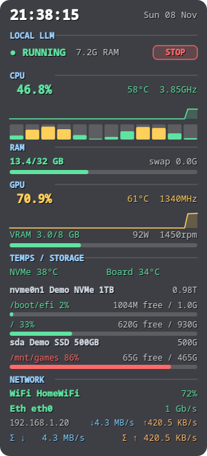

# Linux Sysmon

> **Linux only.** Reads Linux `/sys` and `/proc` interfaces (hwmon, DRM, net, block devices) and uses `lsblk`, `nmcli` and `systemctl`. It does **not** run on Windows or macOS, and there are no plans to port it.

A lightweight, **transparent desktop system-monitor overlay** for Linux. It sits on your desktop like a Conky widget but is a single Python + Qt (PySide6) file, with graphs, colour-coded warnings and an optional start/stop button for a background service (for example a local LLM server).


*Screenshot taken with `--demo` (fake data).*

## Features

| Section | Shows |
|---------|-------|
| **Clock** | time and date |
| **Service toggle** *(optional)* | status of a systemd **user** service (`RUNNING / LOADING / STOPPING / FAILED / OFF`), its RAM use, and a **START/STOP** button |
| **CPU** | total usage + 60 s graph, temperature, frequency, one bar per hardware thread |
| **RAM** | used / total, swap, bar |
| **GPU** *(AMD)* | usage + graph, temperature, clock, VRAM used/total, power draw, fan speed |
| **Temps / Storage** | NVMe and motherboard temperatures; **every** disk with capacity and, per mounted partition, % used, free and total. Locked LUKS volumes are listed as `locked`. New USB drives appear automatically |
| **Network** | Wi-Fi SSID and signal %, Ethernet link state/speed/IP/rates, combined download/upload with graph |

Bars and numbers turn **yellow above 60 % and red above 85 %** (temperatures: yellow above 60 °C, red above 80 °C).

Interaction: **drag** with the left mouse button to move it, **right-click** for opacity presets (clear / light / medium / dark), click-through mode and quit.

## Requirements

- Linux with Python 3.10+
- `PySide6` (Qt 6) and `psutil`
- `lsblk` (util-linux, present on practically every distro)
- *Optional:* `NetworkManager` (`nmcli`) for Wi-Fi SSID and signal; a systemd user unit for the service toggle

### Where each metric comes from

| Metric | Source | Supported hardware |
|--------|--------|--------------------|
| CPU usage, frequency, per-thread | `psutil` | any |
| CPU temperature | hwmon `k10temp`, `zenpower` or `coretemp` | AMD Ryzen, Intel |
| RAM / swap | `psutil` | any |
| GPU usage, VRAM, temp, power, clock, fan | `/sys/class/drm/card*/device/` and hwmon `amdgpu` | **AMD (amdgpu) only** |
| NVMe temperature | hwmon `nvme` (first drive) | NVMe drives |
| Board temperature | hwmon `nct*`, `it8*`, `w83*`, `asus*`, `acpitz` | most desktop boards / laptops |
| Disks and partitions | `lsblk -J` + `psutil.disk_usage` | any |
| Wi-Fi SSID / signal | `nmcli` | NetworkManager systems |
| Ethernet | `/sys/class/net/<if>/{carrier,speed}` + `psutil` | any |
| Service toggle | `systemctl --user` | systemd |

Metrics a machine doesn't provide are shown as `-` or the section is simplified; the app does not crash on missing sensors. **NVIDIA and Intel GPUs are not supported yet** (the section shows "no supported GPU sensor"). Pull requests welcome.

## Install

```bash
git clone https://github.com/kranmal/linux-sysmon.git
cd linux-sysmon
pip install --user -r requirements.txt      # or use a venv, see below
python3 sysmon.py                           # try it
./install.sh --autostart                    # install launcher + start at login
```

`install.sh` copies the script to `~/.local/bin/sysmon`, adds an app-menu entry and (with `--autostart`) a login autostart entry. Remove everything with `./install.sh --uninstall`.

If your distro blocks system-wide pip (PEP 668): `python3 -m venv .venv && . .venv/bin/activate && pip install -r requirements.txt`, then run `.venv/bin/python sysmon.py`.

Distro packages for the dependencies, if you prefer them: Fedora `sudo dnf install python3-pyside6 python3-psutil`, Debian/Ubuntu `sudo apt install python3-pyside6.qtwidgets python3-psutil`, Arch `sudo pacman -S pyside6 python-psutil`.

## Usage and options

```
sysmon.py [--service-unit UNIT] [--service-title TEXT]
          [--service-health-url URL] [--service-process NAME] [--demo]
```

| Option | Meaning |
|--------|---------|
| `--service-unit UNIT` | Show a toggle for this systemd **user** unit (`systemctl --user`). Omit to hide the section |
| `--service-title TEXT` | Section heading (default `SERVICE`) |
| `--service-health-url URL` | If set, `RUNNING` means this URL returns HTTP 200; until then the state is `LOADING` |
| `--service-process NAME` | Process name whose RAM use is shown next to the status |
| `--demo` | Fake data, for screenshots and testing |

Each option also exists as an environment variable: `SYSMON_SERVICE_UNIT`, `SYSMON_SERVICE_TITLE`, `SYSMON_SERVICE_HEALTH_URL`, `SYSMON_SERVICE_PROCESS`.

Example, toggle for a local llama.cpp server running as a user service:

```bash
./install.sh --autostart --service-unit llama-server --service-title "LOCAL LLM" \
    --service-health-url http://127.0.0.1:8080/health --service-process llama-server
```

## Positioning (important on Wayland)

Wayland apps cannot place themselves or stay "below" other windows, so use your compositor's window rules. See **[docs/CONFIGURATION.md](docs/CONFIGURATION.md)**. For **KDE Plasma** there is a helper that pins the overlay, e.g. top-right:

```bash
./kde-window-rule.sh 1813 20      # logical pixels, see the doc for how to calculate X
```

## Testing

```bash
python3 tests/run_tests.py
```

Renders the overlay offscreen with demo data (with and without the service section) and checks the real sensors on your machine do not crash it.

## Known limitations

- **Tested on one setup:** Fedora-based Bazzite, KDE Plasma 6 on Wayland, AMD Ryzen 5 3600 + Radeon RX 580, NVMe + SATA disks. Other desktops and hardware should mostly work but are untested.
- GPU metrics are AMD-only. Only the first NVMe drive's temperature is shown.
- The always-below / no-taskbar behaviour needs a compositor rule (KDE helper included). On GNOME/Wayland the overlay behaves like a normal window.
- The core-bar grid draws one bar per thread; on CPUs with many threads (64+) the bars become very thin.
- Window position isn't remembered by the app itself; use the window rule.

## Contributing

Issues and pull requests welcome (NVIDIA / Intel GPU support, GNOME positioning notes, more sensors). Run `python3 tests/run_tests.py` first. Reports of what works on other distros and hardware are very useful.

## License

[MIT](LICENSE)
